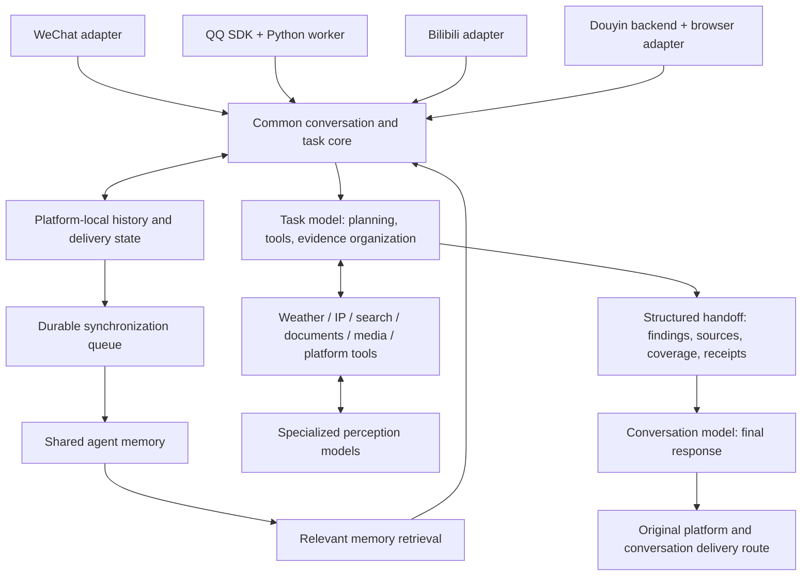

# Cross-Platform Social Agent

**One agent, several apps, shared memory, specialized models.**

[English](#english) · [简体中文](#简体中文)

## English

### The idea

People use several apps at once. A conversation in one app, a document received in another, and a video watched later all become part of the same person's experience. I want to build an agent that works in a similar way: one continuing identity that can chat, read, remember and act across different software environments.

This project connects WeChat, QQ, Bilibili and Douyin to a common agent core. It combines a consistent conversation layer, specialized models, bounded tools and a shared memory store. The goal is an agent that participates in several apps concurrently and carries relevant experience between them.

### The problems I am trying to solve

1. **App isolation fragments memory.** An assistant connected to one account often cannot use relevant context from its conversations in another app. Separate integrations can create several disconnected versions of the same intended assistant.
2. **One model and one adapter rarely cover every task.** Text generation, visual perception, transcription, document reading and platform operations have different requirements. Model capability and integration gaps leave the overall assistant incomplete.
3. **A model request is not persistent memory.** Context windows are finite. Restarting a process, truncating history or omitting previous context can make even a long-running bot appear to forget. Persistence and retrieval need to be designed outside the model request itself.

My proposed answer is a **cross-platform, multi-model conversational agent**: shared experience, one coherent conversational interface, and explicit responsibilities for models and tools.

### Design choices and contributions

The central contribution is how these components work together to sustain an agent's experience across apps. Continuity is implemented in the orchestration, storage and retrieval layers: each model request receives selected context from the ongoing record. The following choices guide the implementation:

| Design choice | Purpose |
| --- | --- |
| A shared experience layer | Bring recorded conversations and sourced video observations into a retrievable history, so later conversations can draw on relevant earlier activity. |
| Separate conversation, task and perception roles | Keep a consistent conversational identity while assigning planning, evidence gathering and media understanding to suitable components. |
| Memory with relevance, time and provenance | Preserve who said something, where it came from and when it applied; select useful memories within a bounded context budget. |
| Capabilities behind platform adapters | Reuse understanding and utility modules while adapting connection, permissions and delivery to each app. Douyin's hybrid transport is one example of choosing a transport for each operation. |
| Explicit execution and delivery state | Track what was understood, what an operation actually returned, and whether its result was delivered; use persisted handoffs for supported recovery. |

Together, these choices form a continuing loop: **participate → acquire evidence → retain experience → retrieve relevant context → respond or perform an authorized action**. For example, a discussion on QQ and a recorded video analysis can inform a later WeChat conversation. This depends on the information actually retained and, when identifying a person across apps, an explicit identity association. The agent does not infer new permission to publish or send from an old memory.

### Functional areas

| Area | Implementation | Capabilities and current boundaries |
| --- | --- | --- |
| WeChat | Windows client automation through the wxauto family | Private/group chat; image, speech, video and document understanding; quotes, recall, nudges, existing-media sending, group operations and Moments publishing/comment workflows. Depends on client compatibility and account permissions. |
| QQ | Official QQ bot SDK in Node.js, with a private JSON-lines bridge to Python | Allowlisted private/group chat; image understanding, speech transcription, MP4 and common-document reading. Optional Qzone publishing needs a separate authorized publishing service. Uses a bot identity. |
| Bilibili | Authenticated platform requests and browser video workflows | Private messages, search, video metadata, per-part subtitles and Q&A, browsing, analysis and comment sharing. Mention notifications and tracked-thread replies have separate switches. |
| Douyin | Backend private messaging/media acquisition, browser comment publishing | Bound contacts' private text chat; fixed video commands, recommendation/topic acquisition, sampled understanding, genuine @ selection in the comment editor, and private-message results. The API inbox currently accepts personal text messages only. |
| Shared assistance | Common tools exposed through platform adapters | Time, weather, public-IP-based location, search with fallback, link reading and memory retrieval. |

These are implemented paths, not a claim that every feature is enabled or verified for every account. See [platform notes](docs/platforms.md).

### Architecture: one agent across multiple processes



Each platform retains its own connection and event loop. Different sessions can be processed concurrently; a session lock keeps the same conversation in order. A cross-process scheduler bounds model concurrency and queueing. The example allows two simultaneous model requests.

### Unified coordination and model division of labor

The agent has one intended conversational identity. Each model supplies a capability rather than independently becoming another social persona.

| Role | Current implementation | Responsibility |
| --- | --- | --- |
| Final conversation | `deepseek-chat` | Explain results in a consistent voice using the conversation, relevant memories and actual task results. |
| Task coordination | `deepseek-flash` | Prepare tasks, select exposed tools, organize evidence and create a structured handoff. Configured simple greetings can bypass this stage. |
| Image perception | Configured Qwen vision model | Describe visible content and read text as evidence for the upper layers. |
| Speech perception | Configured Qwen ASR model | Transcribe acquired audio; QQ's supplied transcription can be used first. |
| Video perception | Qwen video/omni pipeline or sampled-frame pipeline | Interpret the acquired interval, frames and available sound. |
| Document reading | Local parsers, task-model text analysis and Qwen PDF analysis | Extract text, analyze PDFs as files, and convert visual Office documents to PDF when needed. |

Model names and endpoints are configurable. The task model receives only tools exposed for the current platform and message. The final conversation stage receives findings, sources, failures and actual operation receipts; the task model's internal reasoning is not forwarded as conversation history.

This handoff also has a durability purpose: supported reply jobs checkpoint the prepared findings and receipts before final generation. If that final stage fails, it can be retried from the saved handoff without rerunning completed tools. An uncertain external send or an unfinished operation still requires separate handling. Keeping these stages explicit helps preserve task context across model calls and avoids treating a generated answer as proof of a completed action.

Fixed acknowledgements, video interpretations and completion notices also have their own paths. This division describes the common chat pipeline, not a guarantee that every piece of outgoing text passes through the final chat model.

### How the modules work together

**Social chat.** Adapters normalize events, preserve sender/conversation identity, apply allowlists and group rules, and hand requests to the common core. Replies return through the original bound route. Event IDs and delivery records distinguish prepared, sent, failed and uncertain outcomes, so an uncertain send is not blindly repeated.

**Documents and multimodal messages.** WeChat and QQ reuse the common document module for PDF, DOCX, XLS/XLSX, PPTX and text formats. Downloading and extraction have limits. Text, visual pages and audio go through the appropriate components, then become evidence for the conversational layer. Attachments are external material, not instructions to execute actions or declarations of the sender's preferences.

**Moments and publishing.** WeChat has explicit publishing and comment-followup workflows; QQ has an optional Qzone adapter. Publishing is a platform action with its own permissions and result checks. Generated copy and a confirmed external publication are different states.

**Browsing videos.** The workflow obtains recommendation or topic candidates, opens/acquires selected videos, samples available content, organizes an interpretation and can share it through comments or messages. It is inspired by how people browse and discuss videos; it does not imply continuous full-length human viewing. Light mode uses title and sampled frames. Deep mode adds evidence gathering, available audio/ASR and independent review. Reports retain sources, coverage and verification status. Backend media acquisition is not confirmed browser playback.

In deep mode, individual claims refer to collected evidence IDs. A separate review step checks those claims against the sources and can request additional observations around uncertain timestamps within a retry budget. Unresolved conclusions are withheld from that mode's automatic-comment path. The same model may perform drafting and review; a separate review call does not guarantee correctness. Light mode has its own policy and does not inherit this review result.

**Memory across terminals.** Platform databases preserve local history, routing and delivery state. A durable synchronization path feeds one shared agent memory database. Retrieval selects relevant records by query, source, time and recent/long/core priority instead of attaching the entire archive to every request. Explicit identity linking keeps different people distinct until there is a reliable association. Current retrieval uses indexed lexical matching and rules; it is not vector memory or perfect recall.

| Memory tier | Intended use | Retention and retrieval behavior |
| --- | --- | --- |
| Recent | Ongoing exchanges and recent activity | Time-sensitive retrieval with decaying weight. |
| Long-term | Stated preferences, stable background and reinforced statements | Slower decay; repeated statements can gain weight without replayed events being counted again. |
| Core | Explicit requests to remember and manually pinned statements | No automatic weight decay; still selected according to relevance and time eligibility. |

Relative expressions such as “today” remain tied to the original statement's date. Sources distinguish user statements, generated replies and video observations, with delivery status where recorded. Once a local event and its synchronization job are persisted, a temporary shared-store failure can leave pending work for retry. This gives the agent a recoverable experience record while keeping recall selective.

The current implementation assumes the participating processes can access the same shared SQLite database path. Deployment across independent machines would require an additional synchronization or service layer; the repository does not provide automatic cloud or internet-wide memory synchronization.

**Weather, IP and search.** Public-IP location can provide a weather location when no city is supplied. It describes the running machine's approximate location, not the remote chat participant's location. Search supports ordered DuckDuckGo, Baidu and Bocha fallback, retaining the actual provider and source links. Old weather and search memories do not replace fresh queries.

### Repository layout

```text
social_bot/                  Agent core, memory, scheduler and tools
  platforms/                 WeChat / QQ / Bilibili / Douyin adapters
  modules/                   Documents, vision, speech, weather, search, etc.
qq/                          SDK bridge and public templates
bilibili/, douyin/            Platform templates and attribution
scripts/                     Local initialization and publication checks
tests/                       Regression and offline integration tests
docs/                        Platform, configuration and privacy notes
third_party/README.md        Optional external-backend setup
run_*.py                     Stable command-line entry points
private/                     Ignored: keys, account files and archives
data/, reports/, picture/    Ignored: runtime data, logs and local media
```

Active `config.json` files are local-only and ignored; their templates are versioned. Existing deployments may keep databases and browser profiles outside this directory. Those stores are private too. Machine-specific notes and configuration backups belong in the ignored archive.

### Local setup

The complete desktop workflow targets Windows. Individual Python components and tests can run independently; WeChat automation needs a compatible Windows client. Python 3.12 and Node.js 20+ are the intended local environment.

```powershell
python -m venv .venv
.venv/Scripts/Activate.ps1
python -m pip install -r requirements.txt -r douyin/requirements.txt
npm --prefix qq ci --ignore-scripts
python scripts/init_local.py
```

The initializer preserves existing files and creates local configuration/memory paths. Fill the local key and account files in [configuration notes](docs/configuration.md), configure allowlists, and enable the modules you need. Public templates have empty account allowlists and platform-level publishing workflows disabled.

```powershell
python run_qq.py --check
python run_douyin.py check
python run_bilibili.py check
python run_wechat.py
python run_qq.py
python run_bilibili.py listen
# After preparing a separate API configuration and bound account:
python run_douyin.py listen --config douyin/config.api.local.json
```

The launcher reads platform defaults. A separate Douyin API configuration must be selected explicitly; it is not substituted silently. The optional backend uses an isolated environment: see [third-party setup](third_party/README.md).

### Verification and limitations

```powershell
python -m unittest discover -s tests -q
npm --prefix qq test
python run_pipeline_check.py
python scripts/check_publication.py
```

Offline tests exercise control flow, memory, model handoffs and delivery state with fixtures. They do not prove that an account can send real messages, every event will be delivered, or a model will understand every document. Login state, verification challenges, client versions and platform changes can interrupt operation. Douyin API reconnection does not backfill missed messages; its API inbox does not yet handle group or multimedia messages. Video understanding remains limited to acquired evidence.

This is an evolving personal research project. The longer-term direction is more consistent cross-app context, memory correction, clearer task state and broader coverage—not a claim of human-level understanding, complete autonomy or universal app control.

### Privacy and attribution

Keys, cookies, private keys, account bindings, conversations, screenshots, browser profiles, reports and personal media stay local. The publication guard checks the Git index for private paths, common secret formats and known local values. See [privacy and publication](docs/privacy.md).

Use accounts and automation permissions you control. Platform restrictions and manual verification still apply. Upstream notices are retained in [THIRD_PARTY_NOTICES.md](THIRD_PARTY_NOTICES.md) and platform license files. The optional Douyin backend is not bundled or relicensed here.

---

## 简体中文

### 我的设想

我们每天会同时使用多个软件：在一个软件里聊天，在另一个软件里收到文件，之后又去看视频。这些活动会成为同一个人的经历。我想创造一个以类似方式存在的聊天智能体：它拥有持续的身份，可以跨软件聊天、阅读、记忆和执行任务。

本项目把微信、QQ、B站和抖音接入同一个智能体核心，通过统一的对话表达、多个模型的分工、明确边界的工具，以及共享记忆库，让它能够同时活跃在多个社交账号中，并把相关经历带入之后的交流。

### 我希望解决的问题

1. **App 隔离造成记忆不同步。** 同一个智能体接入不同软件后，往往变成多个相互独立的机器人。在一个软件里认识的人、聊过的内容和获得的经历，无法自然进入另一个软件里的对话。
2. **单一模型的能力和平台适配存在缺口。** 文本表达、图片理解、语音识别、文件阅读和软件操作有不同要求。只依赖一个模型或适配器，很难把这些功能完整地连接起来。
3. **模型调用的上下文不等于持久记忆。** 即使程序一直运行，上下文窗口有限、历史截断、进程重启，或某次请求没有带上相关资料，都可能让智能体表现得像“忘记了”。因此，记忆的保存、整理和召回应由模型请求之外的系统承担。

我的方向是一个**跨平台、基于多模型协作的综合聊天智能体**：对外是统一的身份和交流体验，背后由不同模型和工具承担各自适合的任务。

### 设计重点与项目贡献

这项探索的重点，是让不同组件协作起来，维持智能体跨软件的连续经历。连续性由任务编排、存储和召回层实现，每次模型请求从持续积累的记录中取得所需上下文。实现中主要坚持以下设计：

| 设计选择 | 希望达到的效果 |
| --- | --- |
| 共享经历层 | 把已记录的聊天和有来源的视频观察纳入可召回的历史，让之后的交流能够参考相关经历。 |
| 对话、任务与感知分工 | 保持统一的交流身份，同时让适合的组件承担任务计划、取材和多媒体理解。 |
| 带相关性、时间和来源的记忆 | 保留是谁说的、来自哪里、何时有效，并在有限上下文中选取有用信息。 |
| 通过平台适配器提供能力 | 复用理解与辅助模块，分别适配连接、权限和投递方式；抖音混合通道体现了按操作选择实现方式的思路。 |
| 明确的执行与投递状态 | 区分理解结果、操作回执和实际送达，并通过持久交接支持限定范围内的故障恢复。 |

这些设计共同形成一个持续循环：**参与交流 → 获取证据 → 保留经历 → 召回相关上下文 → 回复或执行已授权动作**。例如，QQ 中的一次讨论和已记录的视频分析，可以成为后续微信交流的参考。能否接续取决于实际保留的信息；判断跨平台是否为同一个人时，还需要明确的身份关联。旧记忆不会自动赋予新的发布或发送权限。

### 已连接的功能板块

| 板块 | 实现方式 | 功能与当前边界 |
| --- | --- | --- |
| 微信 | wxauto 系列 Windows 客户端自动化 | 私聊、群聊；图片、语音、视频与文档理解；引用、撤回、拍一拍、已有媒体发送、群操作，以及朋友圈发布与评论流程。依赖微信版本和账号权限。 |
| QQ | 腾讯官方机器人 SDK，Node.js 与 Python 私有 JSON-lines 通道 | 白名单私聊和群聊、图片理解、语音转写、MP4 与常用文档读取；可选 QQ 空间发布需要独立授权服务。使用机器人身份。 |
| B站 | 登录态接口与浏览器视频流程 | 私信、视频搜索、详情、分P字幕与问答，以及刷视频、分析和评论分享；@通知与评论楼回复由独立开关控制。 |
| 抖音 | 后台私信和媒体取材，加浏览器评论发布 | 已绑定好友的文字私信；固定刷视频指令、推荐或话题取材、采样理解、在真实编辑器中选择 @ 对象，再通过评论和私信返回结果。后台收件入口当前仅支持个人文字。 |
| 公共辅助模块 | 各端适配器调用共享工具 | 时间、天气、公网 IP 定位、多后端搜索、链接读取和记忆召回。 |

这些是已存在的实现路径。是否启用、是否在某个账号完成真实验收，需要分别判断，详见[平台说明](docs/platforms.md)。

### 统一智能体与背后模型的分工

对话层保持统一身份和表达风格。多模型协作发生在内部，不要求每个模型分别扮演独立的社交角色。整体流程是：

**平台来信 → 范围检查与上下文 → 相关记忆召回 → 任务模型统筹工具 → 专门模型感知资料 → 整理有来源的结果 → 对话模型生成回复 → 原会话投递。**

| 角色 | 当前实现 | 负责内容 |
| --- | --- | --- |
| 最终聊天表达 | `deepseek-chat` | 结合当前对话、相关记忆和实际任务结果，以统一口吻回复。 |
| 任务统筹与整理 | `deepseek-flash` | 理解任务、选择本轮工具、整理证据、记录失败和操作回执，向聊天模型交接。可配置简单寒暄直接进入聊天模型。 |
| 图片感知 | 配置的千问视觉模型 | 识别可见画面和文字，将结果作为资料交给上层。 |
| 语音感知 | 配置的千问 ASR 模型 | 转写实际取得的音频；QQ 已提供转写时可优先使用。 |
| 视频感知 | 千问视频/音画管道，或采样帧管道 | 根据实际取得的区间、画面及可用声音组织证据。 |
| 文件阅读 | 本地解析器、任务模型文本分析、千问 PDF 图文分析 | 提取文字、分析 PDF 原文件，在需要时把含视觉内容的 Office 文档转成 PDF。 |

模型和接口可以配置。任务模型只能调用当前平台、当前消息所暴露的工具；最终聊天模型接收结论、来源、覆盖范围、失败信息和实际回执，不把任务模型的内部推理当作聊天历史传递。

这种交接也承担恢复任务上下文的作用：受支持的回复任务会在最终生成前保存整理结果和回执。最终回复阶段失败时，可以从已保存的交接继续生成，避免再次执行已完成的工具。外部发送结果未知、操作尚未完成等情况仍需分别处理。明确这些阶段，既有助于跨模型调用保留任务信息，也能避免把“生成了回答”误当作“动作已经成功”。

固定确认、视频解读和任务完成提醒还有各自的生成路径。上述分工描述公共聊天链路，不意味着每一段发送文字都经过最终聊天模型。

### 每个板块的具体思路

**社交聊天。** 平台负责连接和消息监听，把不同格式转成公共事件，保留发送者、会话和消息身份，并执行白名单、群激活或 @ 规则。公共核心处理上下文、工具和回复，适配器把结果发回原会话。去重和投递记录区分准备完成、发送成功、失败与结果未知，避免不确定时盲目重复操作。

**文件与多模态识别。** 微信和 QQ 共用文档模块，支持 PDF、DOCX、XLS/XLSX、PPTX 和常见文本格式。下载、解析和上下文都有预算。文字、图文页面、图片、语音分别交给适合的组件，再作为资料进入对话。文件里的命令不会自动成为执行要求，其中的个人表述也不应被当作发送者的偏好。

**朋友圈与发布。** 微信提供朋友圈发布和评论跟进；QQ 有可选空间发布适配。发布属于平台动作，需要对应权限和结果检查。“生成了文案”和“确认发布成功”是不同状态。

**效仿人类刷视频。** 从推荐或话题候选开始，打开或取得视频，读取可用内容，组织理解，再通过评论或私信交流。轻读使用标题和采样帧；深度模式增加取材、可用音轨/ASR 和独立复核。报告保留来源、覆盖范围与复核状态。这是受人类浏览方式启发的流程，不等于持续观看完整视频；后台下载也不能当作已产生网页播放记录。

深度模式要求逐条结论引用采集证据的编号，再由单独的复核步骤对照来源检查；存在疑点时，可在重试预算内围绕相应时间点补采。未解决的结论不会进入该模式的自动评论流程。起草和复核可能使用同一个模型，单独复核不保证结论一定正确；轻读模式使用独立策略，不自动具备这一复核结果。

**多终端共享记忆。** 平台数据库保留本地会话、路由和投递记录，通过持久同步链路把经历写入同一个智能体记忆库。召回按问题相关性、时间和近期/长期/核心层级筛选资料，而不是每次把整个库塞给模型。跨平台身份需要可靠关联，不会仅凭同名认定是同一个人。当前使用索引匹配和规则排序，尚不是向量记忆或保证永不遗忘的系统。

| 记忆层级 | 主要用途 | 保留和召回方式 |
| --- | --- | --- |
| 近期 | 当前交流和最近经历 | 按时间有效性召回，权重随时间衰减。 |
| 长期 | 明确表达的偏好、稳定背景及反复强化的陈述 | 衰减更慢；重复表达可以强化，事件重放不重复计数。 |
| 核心 | 明确要求记住或人工固定的陈述 | 权重不自动衰减，但仍按相关性和时间有效性参与召回。 |

“今天”等相对时间会绑定到原始发言日期；用户陈述、生成回复和视频观察保留不同来源，在有记录时还附带投递状态。本地事件及同步任务完成持久化后，共享库暂时不可用时可以留下待办，之后重试。这使经历记录能够恢复，同时保持每轮召回的选择性。

当前实现要求参与进程能够访问同一个共享 SQLite 数据库路径。如果部署在彼此独立的机器上，还需要额外的同步或服务层；本仓库尚未提供自动云端或跨互联网的记忆同步。

**天气、IP 与搜索辅助。** 没有明确城市时，可以用公网 IP 近似位置辅助查询天气；该位置属于运行机器，不是远端聊天用户。搜索支持 DuckDuckGo、百度、博查有序回退，并保留实际服务来源和链接。记忆中的旧天气、旧搜索不能替代实时查询。这些模块拓展智能体在日常交流中的实用能力。

**同时聊天与资源协调。** 四端分别运行连接和事件循环，不同会话可以并发，同一会话用锁维护顺序。跨进程调度器统一限制模型请求和排队，默认示例最多两个请求同时进行，避免多个聊天端和视频任务分别占满资源。

### 目录组织与部署

源码集中在 `social_bot/`；平台目录保留公开模板、桥接代码及来源说明；`scripts/` 放初始化和发布检查，`tests/` 放回归测试，`docs/` 放公开文档。根目录 `run_*.py` 保留原有启动命令。

`private/` 存放本地密钥、账号凭据和历史归档；`data/`、`reports/`、`picture/` 与各端实际 `config.json` 均被 Git 忽略。项目外保存的数据库和浏览器登录资料也属于私密运行数据。

完整桌面流程面向 Windows，微信需要兼容客户端，使用 Python 3.12、Node.js 20 及以上。安装命令见英文部分。`python scripts/init_local.py` 会从模板生成配置和目录，并保留已有文件。随后填写密钥、配置账号和白名单，再按需开启功能，见[配置说明](docs/configuration.md)。

入口包括 `run_wechat.py`、`run_qq.py`、`run_bilibili.py listen`。抖音后台混合链路需单独准备 API 配置，并显式执行：

```powershell
python run_douyin.py listen --config douyin/config.api.local.json
```

统一启动器读取各端默认配置，不会自动切换抖音 API 配置。可选后台依赖使用独立环境，见[第三方接入](third_party/README.md)。

### 验证、边界与后续方向

Python 回归、QQ Node 测试和离线链路验证覆盖控制流程、记忆、模型交接和投递状态。它们使用测试资料和替身，不代表真实账号的全部功能已经验收。实际运行仍受登录状态、客户端版本、平台权限、验证提示和接口变化影响。

抖音后台入口目前不接群和多媒体来信；断线重连不会补拉断开期间的消息。视频只理解实际取得的证据，文件和上下文也有长度预算。

后续会继续改进跨软件上下文的一致性、记忆纠错、任务状态可见性和平台功能覆盖。我的目标是让它越来越像一个同时在使用多个软件、拥有连续经历的智能体，而不是把未实现的能力描述为完整自主性、通用电脑控制或人类水平理解。

### 隐私与来源

API 密钥、Cookie、私钥、账号绑定、聊天记录、截图、浏览器登录资料、运行报告和私人媒体仅留本地。发布检查会扫描 Git 暂存区中的敏感路径、常见密钥格式和本机已知敏感值，详见[隐私与发布](docs/privacy.md)。

使用本人控制并有权自动化的账号，遵守平台权限和验证要求。第三方来源及许可保留在[来源说明](THIRD_PARTY_NOTICES.md)和平台许可文件中；可选抖音后台源码不随仓库分发，也不由本项目重新授权。
